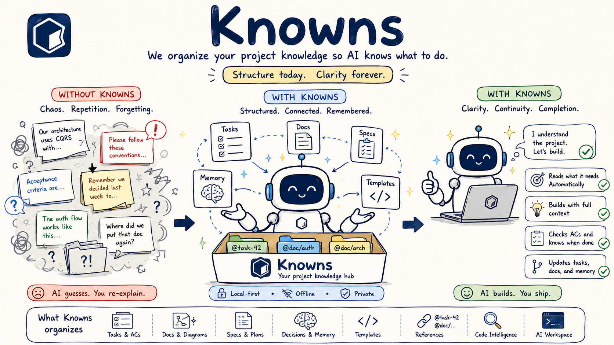
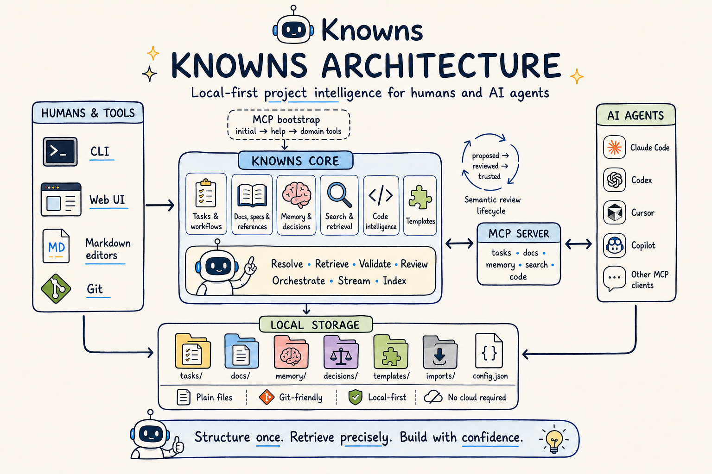
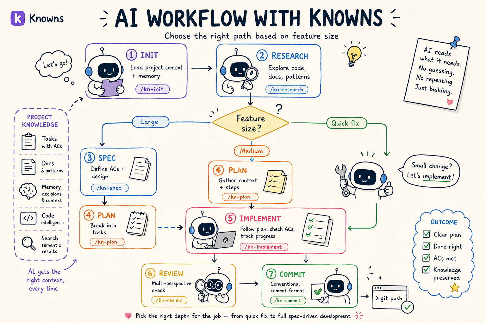

<p align="center">
  
</p>

<h1 align="center">Knowns</h1>

<p align="center">
  <a href="https://bun.sh/"></a>
  <a href="https://github.com/knowns-dev/knowns/releases"></a>
  <a href="https://github.com/knowns-dev/knowns/stargazers"></a>
  <a href="https://github.com/knowns-dev/knowns/actions/workflows/ci.yml"></a>
  <a href="#installation"></a>
  <a href="https://discord.knowns.dev"></a>
  <a href="LICENSE"></a>
</p>

<p align="center">
  
  
</p>

<p align="center">
  <a href="https://knowns.sh">Homepage</a> |
  <a href="./README.vi.md">Tiếng Việt</a> |
  <a href="./docs/README.md">Documentation</a>
</p>

<p align="center">
  <strong>Give your AI coding assistant structured access to tasks, docs, specs, and decisions - so it stops guessing and starts building.</strong>
</p>

---

Every time you start a new AI coding session, you re-explain your architecture, paste docs, repeat conventions, and clarify past decisions. Your AI assistant is powerful - but it forgets everything between sessions.

**Knowns fixes that.** It gives AI assistants like Claude Code, Codex, Cursor, Copilot, OpenCode, and others structured, persistent access to your project's tasks, documentation, specs, acceptance criteria, and architectural decisions. Instead of prompting from scratch, your AI reads what it needs and picks up where you left off.

If you believe AI should truly understand software projects, consider giving **Knowns** a star.

<p align="center">
  <a href="https://player.cloudinary.com/embed/?cloud_name=dkxhoyenc&public_id=knowns-full-pipeline_uwhyk1">
    
  </a>
</p>
<p align="center">
  <em>Click the preview to watch the full pipeline demo video.</em>
</p>

## Table of Contents

- [Why Knowns?](#why-knowns)
- [Before & After](#before--after)
- [What is Knowns?](#what-is-knowns)
- [Who It's For](#who-its-for)
- [How It Works](#how-it-works)
- [Quick Start](#quick-start)
- [Core Capabilities](#core-capabilities)
- [What You Can Build](#what-you-can-build-with-knowns)
- [AI Integrations](#ai-integrations)
- [Agent Skills Workflow](#agent-skills-workflow)
- [Installation](#installation)
- [Documentation](#documentation)
- [Roadmap](#roadmap)
- [Development](#development)
- [Links](#links)

---

## Why Knowns?

AI coding assistants are stateless. Every session starts from zero.

That means you end up doing the same work over and over:

- **Re-explaining** your architecture and design patterns
- **Pasting** documentation into chat windows
- **Repeating** coding conventions and project rules
- **Clarifying** decisions that were already made last week
- **Rebuilding** context that took 20 minutes to set up

The AI doesn't lack intelligence. **It lacks access to what your project already knows.**

Knowns gives it that access.

---

## Before & After

| Without Knowns                                                           | With Knowns                                                                   |
| ------------------------------------------------------------------------ | ----------------------------------------------------------------------------- |
| "We use the repository pattern with..." _(paste 50 lines)_               | AI reads `@doc/patterns/repository` automatically                             |
| "Here's the task, the acceptance criteria are..." _(re-type everything)_ | AI reads the task, its ACs, linked specs, and related docs                    |
| "Remember, we decided last week to..." _(hope it sticks)_                | Choice is stored as a first-class System Decision with a verifiable lifecycle |
| "The auth flow works like this..." _(explain for the 4th time)_          | AI follows `@doc/architecture/auth` and builds on it                          |
| "Are we done? Let me check the requirements again..."                    | AI checks acceptance criteria and validates completion itself                 |
| Session starts cold - 10 min of context-setting                          | Session starts warm - AI already knows the project                            |

---

## What is Knowns?

Knowns is a **local-first, self-hostable project context layer** for AI-native development.

It stores your project knowledge in structured, AI-readable files - and exposes them to AI assistants through CLI and [MCP (Model Context Protocol)](https://modelcontextprotocol.io/).

<p align="center">
  
</p>

Concretely, Knowns manages:

- **Tasks** with acceptance criteria, implementation plans, and status tracking
- **Documentation** in nested markdown folders with cross-references
- **Specs** that define what "done" looks like for a feature
- **Memory** - project-level, session-level, and global knowledge that AI can recall
- **Templates** for code generation with Handlebars
- **References** like `@task-KN-4F7Q2M` and `@doc/patterns/auth` that AI can follow and resolve
- **Code intelligence** - LSP-based symbols, definitions, references, diagnostics, and safe edits

Everything lives in a `.knowns/` directory in your repo. Plain files. Committable to Git. No cloud required.

---

## Who It's For

- **Solo developers** who pair with AI daily and want it to remember project context across sessions
- **Teams** building with AI assistants and tired of everyone re-explaining the same architecture
- **Open-source maintainers** who want contributors (human or AI) to onboard faster
- **Anyone** who uses Claude Code, Codex, Cursor, Copilot, OpenCode, Windsurf, or other AI coding tools and wants them to actually understand the project

---

## How It Works

Knowns sits alongside your existing tools. Your stack stays the same.

<p align="center">
  
</p>

1. **You structure your project knowledge** - tasks, docs, specs, decisions - using the Knowns CLI or Web UI
2. **AI reads it** - through MCP integration or CLI commands, your AI assistant accesses exactly the context it needs
3. **AI acts on it** - follows references, checks acceptance criteria, updates task status, and builds with full awareness
4. **Knowledge accumulates** - decisions, patterns, and conventions persist across sessions instead of disappearing

Your specs -> understood. Your tasks -> connected. Your docs -> usable. Your decisions -> remembered.

---

## Quick Start

```bash
# Install
brew install knowns-dev/tap/knowns
# or: npm install -g knowns
# or: curl -fsSL https://knowns.sh/script/install | sh
# or on Windows PowerShell:
# irm https://knowns.sh/script/install.ps1 | iex

# verify the install
knowns --version

# Initialize in your project
cd your-project
knowns init
# Creates .knowns/ plus lightweight agent shims such as CLAUDE.md/AGENTS.md

# Before starting work, especially after cloning a repository
# that already contains .knowns/
knowns doctor

# or run without a global install
npx knowns init

# Create your first task
knowns task create "Add user authentication" \
  -d "JWT-based auth with login and register endpoints" \
  --ac "User can register with email/password" \
  --ac "User can login and receive JWT token" \
  --ac "Protected routes reject unauthenticated requests"

# Add project documentation
knowns doc create "Auth Architecture" \
  -f "architecture" \
  -d "Authentication design decisions and patterns"

# Open the Web UI
knowns browser --open

# Update Knowns later
knowns update

# Connect to your AI assistant via MCP
# See: docs/en/guides/mcp-integration.md
```

Now when your AI reads the project, it sees structured tasks with acceptance criteria, linked documentation, and clear definitions of done - instead of guessing.

---

## Core Capabilities

### Task & Workflow Management

Create tasks with acceptance criteria, implementation plans, and status tracking. AI can read tasks, follow plans, check off ACs, and know exactly when work is complete.

```bash
knowns task create "Title" --ac "Criterion 1" --ac "Criterion 2"
knowns task edit <id> -s in-progress
knowns task edit <id> --check-ac 1
```

### Structured Documentation

Organize project knowledge in nested markdown folders. Cross-reference with `@doc/path` and `@task-id`. AI follows these references to load exactly the context it needs.

```bash
knowns doc create "API Design" -f "architecture"
knowns doc "architecture/api-design" --smart --plain
```

### Project Memory

Three-layer memory system - **project**, **session**, and **global** - so AI recalls patterns, conventions, and preferences without you repeating them.

```bash
knowns memory create "We use repository pattern for data access" --category pattern
knowns memory list --plain
```

Knowns has two Decision domains: **Spec Decisions** are locked `D1`, `D2`, … rules inside an approved spec that implementers must follow and report; **System Decisions** are first-class records of durable project evolution. New System Decisions always start as drafts and become current only after linked evidence is verified.

```bash
knowns decision create "Use Postgres for metadata" --decision "Use Postgres as the metadata store."
knowns decision link <id> --source @doc/architecture/storage --task <done-task-id>
knowns decision accept <id>
```

Memory category `decision` is legacy and read-only for new writes. Review it with `knowns decision migrate preview`; migration is explicit, one record at a time, and reversible.

### Semantic Search

Search by meaning, not just keywords. Embeddings come from a local [Ollama](https://ollama.com) model and vectors live in a local Qdrant that Knowns manages (or `knowns qdrant setup` for Docker or your own) - offline, no API keys needed.

```bash
knowns search "how does authentication work" --plain
```

### MCP Integration

Full [Model Context Protocol](https://modelcontextprotocol.io/) server. Claude Code, Codex, Cursor, OpenCode, and other MCP-compatible assistants get native access to tasks, docs, memory, search, and validation - no copy-pasting required.

### Code Intelligence

LSP-based code intelligence for supported languages. List symbols, jump to definitions, find references, inspect diagnostics, and make safe symbol-aware edits through MCP.

```bash
knowns lsp list
knowns lsp install <language>
```

### Project Diagnostics

Run `knowns doctor` before starting work, especially after cloning a repository that already contains `.knowns/`. It performs offline, read-only checks for project setup, semantic search, local runtimes, language servers, AI integration artifacts, and runtime-memory hooks. Findings include actionable remediation without applying changes automatically.

```bash
knowns doctor
knowns doctor --scope search,lsp
knowns doctor --verbose
knowns doctor --json --strict
```

### Templates & Code Generation

Handlebars-based templates for scaffolding. Define patterns once, generate consistently.

```bash
knowns template list
knowns template run <name> --var name=UserService
```

### AI Agent Workspaces

Multi-phase agent orchestration with git worktree isolation, live terminal streaming, and automatic phase progression (research -> plan -> implement -> review).

### Web UI

Kanban board, document browser, knowledge graph visualization, and mermaid diagram support - all in a local browser UI.

```bash
knowns browser --open
```

---

## What You Can Build With Knowns

| Capability            | What It Does                                                            |
| --------------------- | ----------------------------------------------------------------------- |
| **Task Management**   | Tasks with acceptance criteria, plans, status, and time tracking        |
| **Documentation**     | Nested markdown folders with cross-references and mermaid support       |
| **Semantic Search**   | Meaning-based search with local AI models (fully offline)               |
| **Time Tracking**     | Built-in timers and reports per task                                    |
| **Context Linking**   | `@task-KN-4F7Q2M` and `@doc/patterns/auth` references AI can resolve           |
| **Validation**        | Detect broken references and incomplete tasks with `knowns validate`    |
| **Template System**   | Code generation with Handlebars (`.hbs`) templates                      |
| **Import System**     | Import docs and templates from git, npm, or local sources               |
| **Memory System**     | Project / session / global memory for persistent AI recall              |
| **MCP Server**        | Native AI assistant integration with full tool access                   |
| **AI Workspaces**     | Multi-phase agent orchestration with worktree isolation                 |
| **Code Intelligence** | LSP-based symbols, definitions, references, diagnostics, and safe edits |
| **Web UI**            | Kanban board, doc browser, knowledge graph, mermaid diagrams            |

---

## AI Integrations

Knowns does not replace your AI assistant. It gives the assistants you already use one shared project context layer: tasks, docs, specs, memory, decisions, search, validation, and code intelligence through MCP and synced skills.

For normal personal setup, use `knowns setup <target> --global`. Use project-level setup only when you intentionally want config files committed or scoped to one repository.

| Assistant                | Setup                                                                | What it gets                                      |
| ------------------------ | -------------------------------------------------------------------- | ------------------------------------------------- |
| Claude Code              | `knowns setup claude --global`                                       | MCP, `/kn-*` skills, runtime memory hooks         |
| Codex                    | `knowns setup codex --global`                                        | MCP, `$kn-*` skills, runtime memory hooks         |
| OpenCode                 | `knowns setup opencode --global`                                     | MCP, `.agents/skills`, plugin/runtime integration |
| Kiro                     | `knowns setup kiro --global`                                         | MCP, skills, runtime hooks                        |
| Cursor                   | `knowns setup cursor --global`                                       | MCP access to Knowns context                      |
| Gemini / Antigravity     | `knowns setup gemini --global` / `knowns setup antigravity --global` | Global MCP config                                 |
| Copilot / generic agents | `knowns setup copilot` / `knowns setup agents`                       | Instruction shims and agent-readable guidance     |

See [Platforms](./docs/en/integrations/platforms.md) for the full mapping.

---

## Agent Skills Workflow

When using Knowns with an agent runtime such as Claude Code or Codex, skills provide a guided workflow:

<p align="center">
  
</p>

```
Tiny change:
/kn-init -> /kn-research -> /kn-plan -> /kn-implement -> /kn-review -> /kn-commit

Feature / approved spec:
/kn-init -> /kn-research -> /kn-spec -> /kn-flow -> /kn-commit
```

### Example Session

Claude Code example:

```
You: /kn-init
Claude: [Reads README, ARCHITECTURE, checks task backlog]
        "Project uses NestJS with CQRS pattern. 3 tasks in-progress..."

You: /kn-plan 42
Claude: [Takes task, reads refs, searches docs]
        "Task #42: Add user authentication

         ## Implementation Plan
         1. Review @doc/patterns/auth
         2. Create AuthModule with JWT strategy
         3. Add login/register endpoints
         4. Write unit tests

         Approve this plan?"

You: Yes

You: /kn-implement 42
Claude: [Follows plan, generates code, checks ACs]
        "✓ AC1: User can login - DONE
         ✓ AC2: JWT token returned - DONE
         ✓ AC3: Tests pass - DONE

         All acceptance criteria complete. Ready to commit?"

You: /kn-commit
Claude: [Creates conventional commit]
        "feat(auth): add JWT authentication

         - Add AuthModule with passport JWT strategy
         - Add login/register endpoints
         - Add unit tests (94% coverage)"
```

### All Skills

Skills are agent workflow commands, not MCP tools. MCP tools show up in `codex mcp` as domain tools such as `tasks`, `docs`, `memory`, `search`, and `code`; skills are synced separately to the agent's skills directory.

| Platform    | Invocation                           |
| ----------- | ------------------------------------ |
| Claude Code | `/kn-spec`, `/kn-flow`, `/kn-review` |
| Codex       | `$kn-spec`, `$kn-flow`, `$kn-review` |

The table below uses Claude Code's `/kn-*` syntax. In Codex, use the same skill name with `$` instead of `/`.

| Skill                       | Description                                                           |
| --------------------------- | --------------------------------------------------------------------- |
| `/kn-init`                  | Initialize session - read docs, load memory, understand project       |
| `/kn-plan <id>`             | Take task, gather context, create implementation plan                 |
| `/kn-implement <id>`        | Execute plan, track progress, check acceptance criteria               |
| `/kn-research`              | Research project context, code, and relevant external MCP/web sources |
| `/kn-handoff`               | Write a cross-repo brief or API contract handoff document             |
| `/kn-commit`                | Create conventional commit with verification                          |
| `/kn-spec`                  | Create specification document for features (SDD)                      |
| `/kn-flow @doc/<spec-path>` | Recommended full approved-spec flow: plan, implement, review, verify  |
| `/kn-go <spec>`             | Legacy full pipeline from approved spec without review gates          |
| `/kn-verify`                | Run SDD verification and coverage report                              |
| `/kn-review`                | Multi-perspective code review (P1/P2/P3 severity)                     |
| `/kn-doc`                   | Create or update documentation                                        |
| `/kn-extract`               | Extract reusable patterns into docs, templates, and memory            |
| `/kn-template`              | List, run, or create code templates                                   |
| `/kn-debug`                 | Debug errors and failures with memory-backed triage                   |

---

## Installation

### Homebrew (macOS/Linux)

```bash
brew install knowns-dev/tap/knowns
```

### Shell installer (macOS/Linux)

```bash
curl -fsSL https://knowns.sh/script/install | sh

# Or with wget
wget -qO- https://knowns.sh/script/install | sh

# Install a specific version
curl -fsSL https://knowns.sh/script/install | KNOWNS_VERSION=0.18.0 sh

# Link into a PATH directory other than ~/.local/bin
curl -fsSL https://knowns.sh/script/install | KNOWNS_LINK_DIR=/opt/homebrew/bin sh
```

### PowerShell installer (Windows)

```powershell
irm https://knowns.sh/script/install.ps1 | iex

# Install a specific version
$env:KNOWNS_VERSION = "0.18.0"; irm https://knowns.sh/script/install.ps1 | iex
```

If semantic search reports a missing local model, run `knowns search --setup` or download one explicitly with `knowns model download <model-id>`, then rebuild with `knowns search --reindex`.

### npm

```bash
# Global install - auto-downloads platform-specific binary
npm install -g knowns

# Or run without installing
npx knowns
```

### From source (Bun 1.3.12+)

Knowns is built with [Bun](https://bun.sh) as a single self-contained binary. Bun is only needed to build it.

```bash
git clone https://github.com/knowns-dev/knowns.git
cd knowns
(cd ui && bun install && bun run build)   # the binary embeds the built Web UI
cd cli && bun install
bun run build bun-darwin-arm64            # Output: cli/dist/darwin-arm64/knowns
```

Pick your platform's target: `bun-darwin-arm64`, `bun-darwin-x64`, `bun-linux-x64`, `bun-linux-arm64`, `bun-windows-x64` or `bun-windows-arm64`. With no target, `bun run build` builds all six. Copy the binary to a directory on your `PATH`.

> Releases up to 0.34.1 were written in Go. That code still lives in `cmd/` and `internal/` as the reference the TypeScript build is tested against; `go install github.com/howznguyen/knowns/cmd/knowns@latest` builds 0.34.1, not the current release.

### Uninstall

Use the method that matches how you installed Knowns:

```bash
# Homebrew
brew uninstall knowns

# npm
npm uninstall -g knowns

# Shell installer (macOS/Linux)
curl -fsSL https://knowns.sh/script/uninstall | sh

# Go install (0.34.1 and earlier)
rm -f "$(go env GOPATH)/bin/knowns"
```

```powershell
# PowerShell installer (Windows)
irm https://knowns.sh/script/uninstall.ps1 | iex
```

If you installed runtime memory adapters, remove them before uninstalling the CLI:

```bash
knowns runtime uninstall codex
```

Uninstall removes CLI binaries and PATH entries added by the installer. It leaves project `.knowns/` folders, tasks, docs, memories, and AI integration files untouched. Delete `.knowns/` only if you intentionally want to discard project context.

---

## Quick Reference

```bash
# Tasks
knowns task create "Title" -d "Description" --ac "Criterion"
knowns task list --plain
knowns task <id> --plain
knowns task edit <id> -s in-progress -a @me
knowns task edit <id> --check-ac 1

# Documentation
knowns doc create "Title" -d "Description" -f "folder"
knowns doc "doc-name" --plain
knowns doc "doc-name" --smart --plain
knowns doc "doc-name" --section "2" --plain

# Templates
knowns template list
knowns template run <name> --var name=X
knowns template create <name>

# Imports
knowns import add <name> <source>
knowns import sync
knowns import list

# Time, Search & Validate
knowns time start <id> && knowns time stop
knowns search "query" --plain
knowns validate

# Code intelligence
knowns lsp list
knowns lsp install <language>
# Use the MCP code tool for symbols, definitions, references, diagnostics, and edits

# Project diagnostics
knowns doctor
knowns doctor --scope search,lsp
knowns doctor --json --strict

# AI setup
knowns setup agents        # lightweight repo-local agent shims only
knowns setup codex --global # user-level Codex MCP/skills/hooks
knowns setup --global      # interactive user-level AI integration setup
knowns setup               # interactive project integration setup
knowns sync
```

---

## Documentation

| Guide                                                        | Description                                                  |
| ------------------------------------------------------------ | ------------------------------------------------------------ |
| [Installation](./docs/en/getting-started/installation.md)    | Install, verify, run without a global install, and uninstall |
| [User Guide](./docs/en/guides/user-guide.md)                 | Getting started and daily usage                              |
| [Command Reference](./docs/en/reference/commands.md)         | Core CLI commands with examples                              |
| [Workflow Guide](./docs/en/guides/workflow.md)               | Recommended human + AI workflow                              |
| [MCP Integration](./docs/en/guides/mcp-integration.md)       | MCP setup and supported platforms                            |
| [Reference System](./docs/en/reference/reference-system.md)  | How `@doc/` and `@task-` linking works                       |
| [Semantic Search](./docs/en/reference/semantic-search.md)    | Setup and usage of semantic search                           |
| [Templates](./docs/en/integrations/templates.md)             | Code generation and template workflows                       |
| [Web UI](./docs/en/guides/web-ui.md)                         | Board, docs, graph, and config UI                            |
| [Configuration](./docs/en/reference/configuration.md)        | Project config and platform IDs                              |
| [Skills](./docs/en/integrations/skills.md)                   | Skill paths and regeneration                                 |
| [Developer Guide](./docs/en/contributing/developer-guide.md) | Notes for contributors                                       |
| [Platforms](./docs/en/integrations/platforms.md)             | Platform integration mapping                                 |

---

## Roadmap

### AI Agent Workspaces ✅ (Active)

Multi-phase agent orchestration - assign tasks to AI agents with git worktree isolation, live terminal streaming, and automatic phase progression (research -> plan -> implement -> review).

### Self-Hosted Team Sync 🚧 (Planned)

Optional self-hosted sync server for shared visibility without giving up local-first workflows.

- **Real-time visibility** - See who is working on what
- **Shared knowledge** - Sync tasks and documentation across the team
- **Full data control** - Self-hosted, no cloud dependency

---

## Development

Requires **Bun 1.3.12+**. **Go 1.25+** is optional: the parity tests build the Go 0.34.1 reference from `cmd/` and skip the Go comparisons without it.

```bash
make ui                          # Build the Web UI the binary embeds (cd ui && bun run build)
cd cli && bun install
bun run check                    # Typecheck + lint (Biome)
bun run test                     # Unit and parity tests
bun run build bun-linux-x64      # Build one target -> cli/dist/linux-x64/knowns
bun run build                    # Build all 6 targets
bun run cli-docs:check           # CLI reference matches the command tree
```

Parity tests compare the TypeScript CLI with the Go 0.34.1 reference byte for byte. To reuse a Go build instead of building one per run, point `KNOWNS_GO_BIN` at it (`go build -o /tmp/knowns-go ./cmd/knowns`, after `make ui`).

The CLI + MCP E2E suite in `tests/` is written in Go and runs against any binary. Run it through `scripts/go-e2e.sh` (or `scripts/go-e2e.ps1` on Windows), for example `TEST_BINARY=cli/dist/linux-x64/knowns scripts/go-e2e.sh -v`: it gives the suite a temporary home so its test projects never land in your real `~/.knowns`.

#### Web UI development

The Vite dev UI runs on `http://localhost:6421` and calls the API server on `:6420` (`API_URL`).

```bash
make dev-all-ts         # TypeScript server + Vite dev UI
make dev-ui             # Vite dev UI only
make dev-ts             # TypeScript server only
```

The TypeScript web server accepts requests only from its own origin, so the dev UI on another port
must be allowed with `KNOWNS_ALLOWED_ORIGINS` (exact origins, comma-separated, no wildcards).
`make dev-ts` sets it to `http://localhost:6421,http://127.0.0.1:6421`; when you start the server
yourself, set it the same way, or the UI gets `403 untrusted request origin`:

```bash
KNOWNS_ALLOWED_ORIGINS=http://localhost:6421 knowns browser --port 6420 --no-open
```

### Project Structure

```
cli/                 # The Knowns CLI (TypeScript on Bun)
  src/
    main.ts          # CLI entry point
    cli/             # Commands
    models/          # Domain models
    storage/         # File-based storage (.knowns/)
    server/          # HTTP server, SSE, WebSocket
    mcp/             # MCP server (stdio)
    search/          # Keyword and semantic search
    runtime/         # Background runtime daemon
    lsp/             # LSP-based code intelligence
  test/              # Unit and Go parity tests
  scripts/           # Build, fixtures and CLI reference generation
ui/                  # React Web UI (Knowns UI), embedded into the binary
cmd/, internal/      # Go 0.34.1 reference implementation
tests/               # E2E tests (Go)
```

---

## Links

- [npm](https://www.npmjs.com/package/knowns)
- [GitHub](https://github.com/knowns-dev/knowns)
- [Discord](https://discord.knowns.dev)
- [Releases](https://github.com/knowns-dev/knowns/releases)

For design principles and long-term direction, see [Philosophy](./PHILOSOPHY.md).

For technical details, see [Architecture](./ARCHITECTURE.md) and [Contributing](./CONTRIBUTING.md).

---

## Support Knowns

If Knowns helps your workflow, consider supporting its development:

- ⭐ **Star the repo** - helps others discover the project
- 🐛 **Report bugs and suggest features** - your feedback shapes the roadmap
- 💬 **Share with your team** - the more developers who use it, the better it gets
- ☕ **[Sponsor on GitHub](https://github.com/sponsors/howznguyen)** - sustains ongoing development

All contributions help make Knowns better for everyone building with AI.

---

<p align="center">
  <strong>What your AI should have knowns.</strong><br>
  Built for dev teams who pair with AI.
</p>
